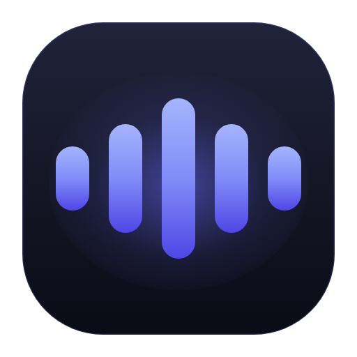
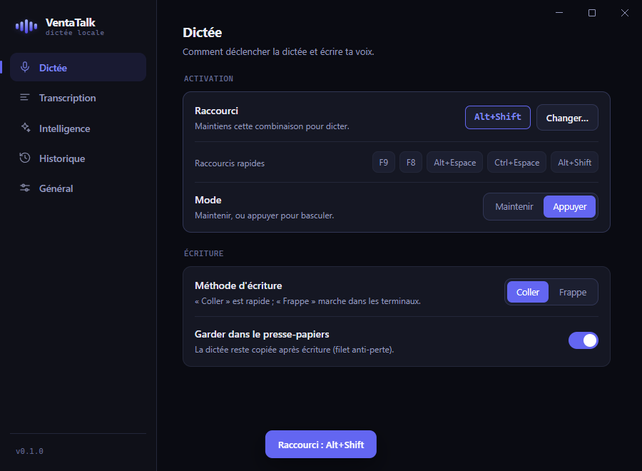
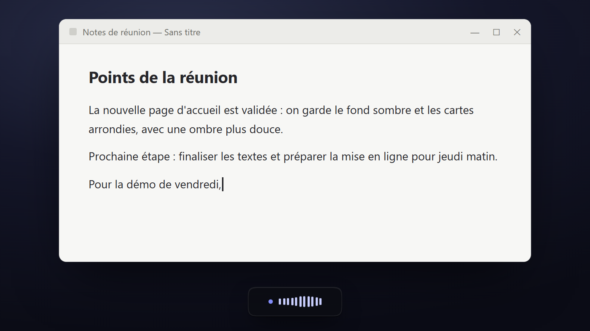
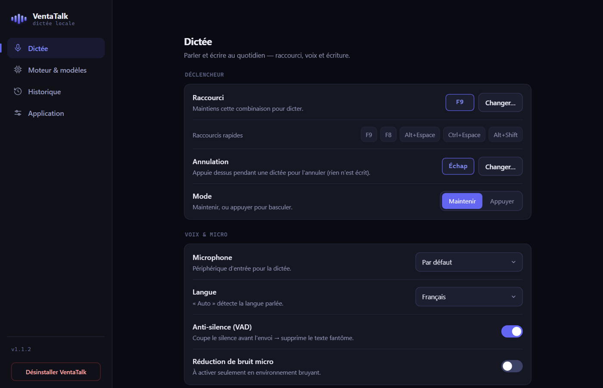
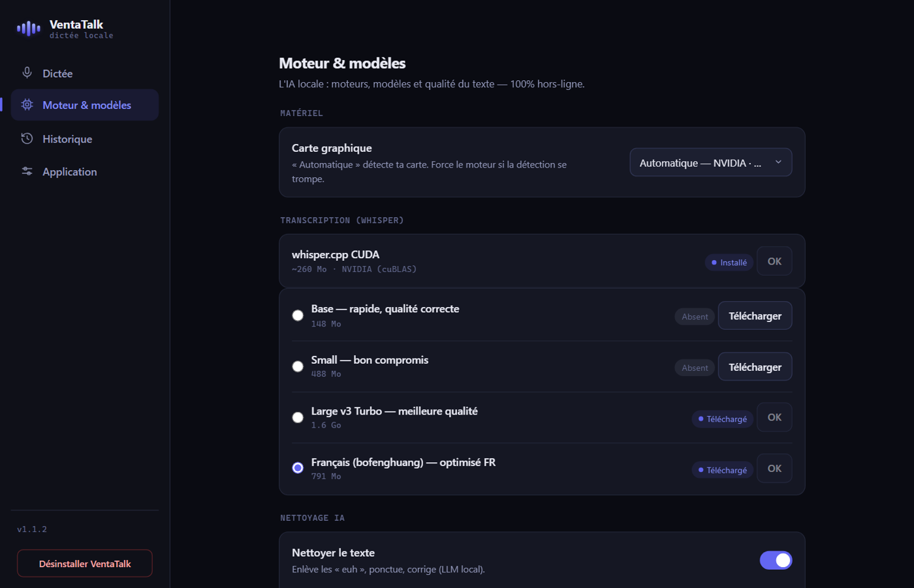
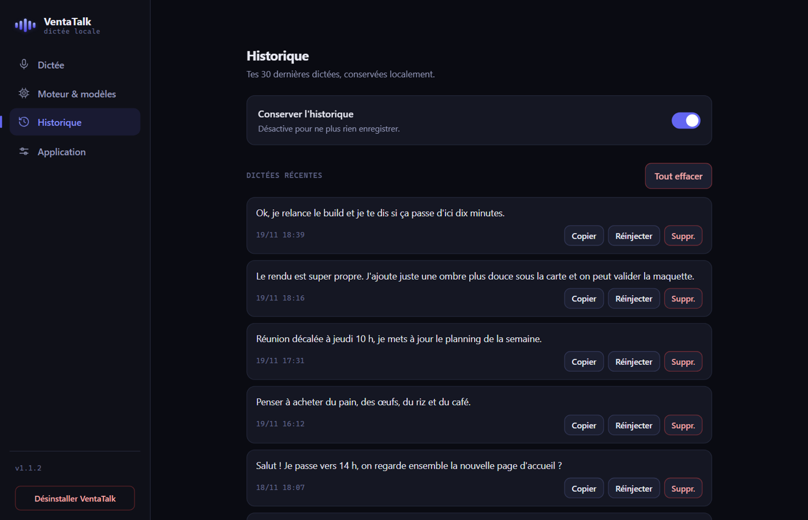
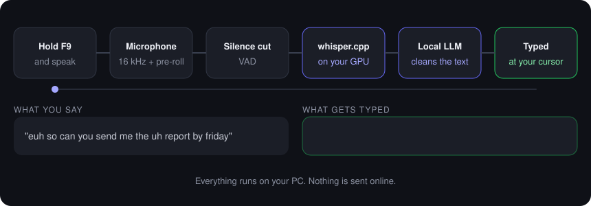

<div align="center">



# VentaTalk

**Voice dictation for Windows that runs entirely on your PC.**
Hold a key, speak, release: your words are transcribed, cleaned up and typed at your cursor, in any app.

[](https://github.com/StyuDEV/VentaTalk/releases/latest)


[](LICENSE)



</div>

## I want to…

| | Where to go |
|---|---|
| **Use it** | [Download the installer](https://github.com/StyuDEV/VentaTalk/releases/latest), then read [Install](#install) |
| **Understand how it works** | [How it works](#how-it-works), with an animated diagram |
| **Build it or read the code** | [Build from source](#build-from-source) and [Project layout](#project-layout) |

> The interface is in French. Dictation works in any language Whisper supports.

## What it does

- **Dictation everywhere.** One global shortcut (**F9** by default). The text is typed where your cursor is,
  in a browser, Word, Discord, a terminal or any other app.
- **Fast, on your graphics card.** Transcription runs with [whisper.cpp](https://github.com/ggerganov/whisper.cpp)
  on the GPU (CUDA for NVIDIA, Vulkan for AMD and Intel). The model stays loaded, so short dictations come back in
  about a third of a second.
- **Clean text, your style.** A small local language model (Qwen 2.5 3B) removes the "uh"s, adds punctuation and
  fixes obvious mistakes, without rewriting what you said. Your tone and your slang stay.
- **Private by design.** No account, no server, no telemetry. Audio, text and history never leave your computer.
- **Made for daily use.** Hold-to-talk or press-to-toggle, a cancel key (Escape), your own word replacements,
  a dictation history, microphone choice, optional muting of other sounds while you speak, and automatic updates.

<p align="center">
  
  <br><sub>The dictation bar while you speak (the notes window is only there for the demo).</sub>
</p>

## Install

**Requirements**

- Windows 10 or 11, 64-bit
- A graphics card: NVIDIA (CUDA), or AMD / Intel (Vulkan)
- About 1 GB of disk space for the engine and one model

**Steps**

1. Download **`VentaTalk-Setup-x.y.z.exe`** from the [latest release](https://github.com/StyuDEV/VentaTalk/releases/latest).
2. Run it. The app is not code-signed, so Windows SmartScreen may say "unknown publisher":
   click **More info → Run anyway**.
3. On first launch, the settings window lets you download the **GPU engine** and a **model**.
4. Hold **F9**, speak, release. That's it.

Engines, models and history are stored in `%APPDATA%\ventatalk`. They are downloaded once.

## Usage

| Action | Default |
|---|---|
| Dictate | Hold **F9**, speak, release |
| Toggle mode | Press once to start, once to stop (setting **Mode → Appuyer**) |
| Cancel the current dictation | **Escape** |
| Settings, history, quit | Tray icon (bottom right of the taskbar) |

**Choosing a model**

| Model | Best for |
|---|---|
| Base | Fastest, fine for short notes |
| Small | Good balance of speed and accuracy |
| Large v3 Turbo | Best accuracy across languages |
| French (bofenghuang, distilled) | Best accuracy in French, fewer made-up words |

<table>
  <tr>
    <td></td>
    <td></td>
    <td></td>
  </tr>
  <tr>
    <td align="center"><sub>Shortcuts, microphone, language</sub></td>
    <td align="center"><sub>GPU engine and Whisper models</sub></td>
    <td align="center"><sub>Local history, copy or re-type</sub></td>
  </tr>
</table>

## How it works

<p align="center"></p>

1. **Shortcut.** A global keyboard hook ([uiohook-napi](https://github.com/SnosMe/uiohook-napi)) sees the key go
   down and up, in every app.
2. **Microphone.** Audio is recorded at 16 kHz with a short pre-roll, so the first word is never cut.
3. **Silence cut.** Voice activity detection trims the silence, which keeps Whisper from inventing words.
4. **Transcription.** A local whisper.cpp server, kept running with the model in GPU memory, turns the audio into text.
5. **Clean-up.** Filler words and your replacements are applied, then the local LLM fixes punctuation and typos.
6. **Typing.** The text is pasted or typed at the cursor ([nut.js](https://github.com/nut-tree/nut.js)).

No network request is made while you dictate. The only downloads are the engine, the models and app updates,
all from public URLs (GitHub and Hugging Face).

## Build from source

Requires Windows and a current [Node.js](https://nodejs.org) LTS.

```bash
git clone https://github.com/StyuDEV/VentaTalk.git
cd VentaTalk
npm install
npm run dev        # run the app (it lives in the tray)
npm test           # unit tests
npm run typecheck  # TypeScript checks
npm run dist       # build the Windows installer into dist/
```

## Project layout

```
src/
  main/        Electron main process
    hotkey.ts      global push-to-talk and cancel shortcut
    transcribe.ts  whisper.cpp server on the GPU
    cleanup.ts     local LLM clean-up (node-llama-cpp)
    inject.ts      typing the text at the cursor
    models.ts      engine and model downloads
    history.ts     local dictation history
    updater.ts     automatic updates from GitHub Releases
  preload/     safe bridge between the app and its windows
  renderer/
    overlay/   the dictation bar
    settings/  the settings window
resources/     icons and installer assets
scripts/       build and test helpers
```

**Stack:** Electron and electron-vite (TypeScript), whisper.cpp, node-llama-cpp, uiohook-napi, nut.js,
electron-store, electron-updater, electron-builder (NSIS installer).

## Troubleshooting

- **"Unknown publisher" warning.** Expected, the installer is not signed. Use **More info → Run anyway**.
- **Nothing is typed.** Some apps running as administrator refuse input from normal apps. Run VentaTalk as
  administrator too, or dictate elsewhere.
- **No GPU engine.** Dictation needs the GPU engine. Open the settings and install the one for your card.

Found a bug? [Open an issue](https://github.com/StyuDEV/VentaTalk/issues) with your Windows version, your
graphics card and what you did.

## Credits

Built on [whisper.cpp](https://github.com/ggerganov/whisper.cpp) (Georgi Gerganov and contributors),
the [French Whisper model](https://huggingface.co/bofenghuang/whisper-large-v3-french-distil-dec16) by bofenghuang,
[Qwen 2.5](https://huggingface.co/Qwen) and [node-llama-cpp](https://github.com/withcatai/node-llama-cpp).

## License

[MIT](LICENSE) © StyuDEV
